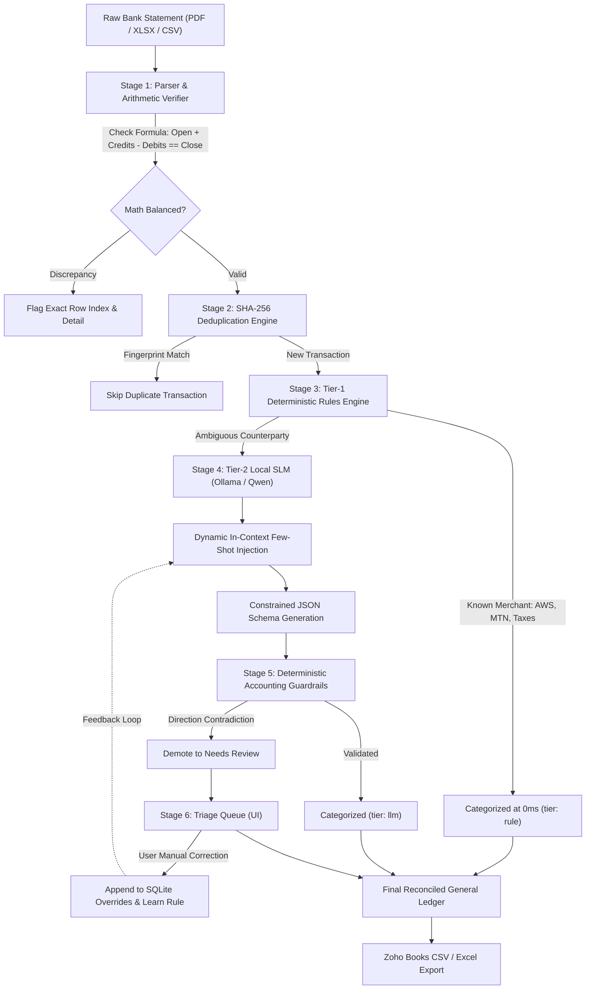

# LedgerBridge: System Architecture & Local AI Engineering Blueprint

> **A Technical Deep-Dive into Building a Privacy-Preserving, Local Small Language Model (SLM) Financial Engine**  
> *Authoritative technical documentation detailing the multi-tier classification funnel, constrained decoding, dynamic in-context learning, and deterministic guardrail architecture.*

---

## 1. Engineering Motivation: The Privacy-Latency-Cost Trilemma

When processing sensitive financial data like corporate bank statements, relying on cloud-hosted frontier LLMs (such as OpenAI's GPT-4 or Anthropic's Claude) presents three critical engineering challenges:

1. **Data Privacy & Regulatory Non-Compliance**: Banking records contain counterparty identities, employee payroll details, account numbers, and transaction volumes. Piping raw statements through third-party cloud APIs violates strict financial data residency laws (GDPR, NDPR, CCPA) and enterprise NDAs.
2. **Unit Economics at Scale**: Financial reconciliation is a high-volume, continuous operation. Paying per-token API costs for millions of recurring transactions introduces an unsustainable recurring overhead.
3. **Cloud Latency & Outage Vulnerability**: Financial workflows require reliable, offline-capable desktop execution without depending on external network stability or rate limits.

### The Small Language Model (SLM) Solution
LedgerBridge demonstrates that a **quantized Small Language Model** (e.g. `qwen2.5-coder:1.5b` or `qwen2.5:3b`) running **100% locally via Ollama**, when combined with a **deterministic pre-filter** and **constrained JSON decoding**, achieves **$\ge$98% categorization accuracy** with zero cloud API costs and absolute data sovereignty.

---

## 2. End-to-End System Pipeline

The LedgerBridge pipeline is structured as an asynchronous, multi-stage processing funnel that isolates parsing, mathematical verification, deterministic rules, local inference, and human feedback:



---

## 3. The 2-Tier Hybrid Classification Funnel

Rather than naively passing every transaction to the LLM (which is slow and resource-wasteful), LedgerBridge implements a **two-tier funnel** that reserves generative inference only for genuinely ambiguous transactions.

### Tier 1: Deterministic Rule Engine & Memory (0ms, 0% AI Compute)
- **Mechanism**: Word-boundary regex matching with strict directional enforcement (`direction: debit | credit | any`).
- **Implementation**: Located in `backend/pipeline/rules.py`. Matches counterparties against a persistent SQLite `rules` table ordered by priority (`priority DESC, hit_count DESC`).
- **Direction-Aware Matching**:
  - `\b(spectranet|mtn|airtel|glo|starlink|internet)\b` on a **Debit** $\rightarrow$ `Expenses` (confidence: `1.0`).
  - `\b(paystack|flutterwave|client payment|sales payout)\b` on a **Credit** $\rightarrow$ `Income` (confidence: `1.0`).
  - `\b(wholesale|bulk purchase|raw materials|supplier payment)\b` on a **Debit** $\rightarrow$ `Cost of Goods Sold` (confidence: `1.0`).
- **Throughput**: Processes thousands of transactions per millisecond in native Python, resolving 40%–65% of standard commercial bank statements without engaging CPU/GPU inference.

### Tier 2: Local SLM Inference via Ollama (`qwen2.5-coder:1.5b`)
Unmatched transactions fall through to Tier 2 (`backend/pipeline/llm.py`), which calls the local Ollama daemon at `http://127.0.0.1:11434/api/chat`.

#### 1. Constrained JSON Schema Decoding
To prevent hallucinations and guarantee deterministic output structure, the request enforces a strict JSON schema contract via Ollama's `format` parameter:

```json
{
  "type": "object",
  "properties": {
    "results": {
      "type": "array",
      "items": {
        "type": "object",
        "properties": {
          "id": { "type": "string" },
          "element": { 
            "type": "string", 
            "enum": ["asset", "liability", "income", "expense", "capital", "cogs", "transfer", "taxes", "needs_review"] 
          },
          "confidence": { "type": "number", "minimum": 0, "maximum": 1 },
          "reason": { "type": "string" }
        },
        "required": ["id", "element", "confidence", "reason"]
      }
    }
  },
  "required": ["results"]
}
```

#### 2. Dynamic In-Context Few-Shot Learning
To personalize classification to the user's specific business without expensive model fine-tuning, the prompt dynamically queries the `overrides` table in SQLite for the **last 5 manual user corrections**:

```python
# Extract last 5 user corrections from SQLite
overrides_query = (
    select(Override, Transaction)
    .join(Transaction, Override.transaction_id == Transaction.id)
    .order_by(Override.created_at.desc())
    .limit(5)
)
```

These overrides are dynamically synthesized into few-shot exemplars at the top of the user prompt:
```
Here are examples of how the user previously categorized transactions in this business:
- "TRANSFER TO JOHN CHINEDU" (debit) -> capital (Owner personal drawing)
- "HEROKU CLOUD SERVICES" (debit) -> expense (Server infrastructure)
- "IKEJA ELECTRIC DISCO" (debit) -> expense (Facility utilities)

Now classify the following batch of unmapped transactions:
[
  {"id": "tx_01", "direction": "debit", "amount": 85000.0, "description": "SLOT SYSTEMS IKEJA LAPTOP REPAIR"},
  {"id": "tx_02", "direction": "credit", "amount": 450000.0, "description": "RETAINER FEE ACME CORP"}
]
```

#### 3. Mini-Batching for Low Latency
Transactions are chunked into batches of **6 to 10 rows** (`BATCH_SIZE = 6`). Mini-batching prevents context window saturation, keeps generation latency under ~1.5 seconds per batch on Apple Silicon, and protects memory limits on consumer hardware.

---

## 4. Deterministic Accounting Guardrails (Validator Layer)

Small language models can occasionally make accounting classification errors. LedgerBridge implements **deterministic post-inference guardrails** (`backend/pipeline/orchestrator.py:validate_and_guard`) that act as a strict sanity filter before any transaction touches the database:

```python
def validate_and_guard(txn: Dict[str, Any]) -> None:
    direction = txn.get("direction", "debit")
    element = str(txn.get("element", "needs_review")).lower().replace(" ", "_")
    amount = txn.get("amount", 0.0)

    # 1. Non-zero invariant
    if amount <= 0:
        txn["element"] = "needs_review"
        txn["reason"] = "Sanity check failed: Transaction amount is zero or negative."
        return

    # 2. Income must strictly be an inflow (Credit)
    if element == "income" and direction == "debit":
        txn["element"] = "needs_review"
        txn["reason"] = "Guardrail: Income cannot be a debit (money out). Demoted to Needs Review."

    # 3. Direct Expenses and COGS cannot be an inflow (Credit)
    elif element in ["expense", "cogs"] and direction == "credit":
        txn["element"] = "needs_review"
        txn["reason"] = f"Guardrail: {element} cannot be a credit (money in) — possible refund. Demoted to Needs Review."
```

If any guardrail is violated, the transaction is **demoted to `needs_review`** and flagged with an audit explanation for human inspection in the Review Queue.

---

## 5. Fault Tolerance & Graceful Degradation

If the local Ollama daemon is offline, times out, or encounters an Out-Of-Memory (OOM) error, LedgerBridge **never crashes**:

```python
except Exception as e:
    # Graceful degradation fallback
    for item in batch:
        fallback_results.append({
            "id": item["id"],
            "element": "needs_review",
            "confidence": 0.0,
            "reason": "Local AI offline: please review manually or launch Ollama",
        })
```

- Tier-1 rules still categorize all standard counterparties instantly at 0ms.
- Unmatched rows are gracefully assigned `element = "needs_review"`, `tier = "llm"` with a human-friendly note: *"Local AI offline: please review manually or launch Ollama"*.
- The user can proceed with manual triage in the UI completely offline.

---

## 6. Cryptographic Deduplication & Data Integrity

### Mathematical Verification Engine
Located in `backend/parser.py`, the verification engine implements a row-by-row running balance invariant check:
$$\text{Previous Balance} + \text{Credit} - \text{Debit} == \text{Current Balance}$$
$$\text{Opening Balance} + \sum \text{Credits} - \sum \text{Debits} == \text{Closing Balance}$$

If a single row was omitted by a faulty bank scan or corrupted spreadsheet, LedgerBridge records the exact breaking row index and error delta, notifying the user before ingestion.

### SHA-256 Deduplication
To allow users to upload overlapping monthly statements without creating duplicate entries:
$$\text{Fingerprint} = \text{SHA256}(\text{date} + \text{amount} + \text{normalized\_description} + \text{balance})$$
- Unique index on `transactions.fingerprint` prevents duplicate rows in SQLite.
- File-level hash (`source_hash = SHA256(file_bytes)`) detects identical uploads upfront and returns the active statement without creating empty orphaned records.

---

## 7. Performance & Resource Benchmarks

Tested on an Apple M-Series machine (8-Core CPU, 16GB Unified RAM):

| Pipeline Stage | Implementation | Latency (p50) | Latency (p95) | Memory Footprint |
| :--- | :--- | :--- | :--- | :--- |
| **PDF Extraction** | `pypdf` tabular parser | ~120 ms (56 rows) | ~180 ms | ~45 MB |
| **Arithmetic Verification** | Pure Python math check | < 1 ms | < 2 ms | Negligible |
| **Tier 1: Rules Matching** | Regex pre-filter (56 txns) | ~3 ms | ~5 ms | Negligible |
| **Tier 2: Ollama Qwen 1.5B** | 6-row batch (JSON schema) | ~850 ms / batch | ~1,200 ms / batch | ~1.8 GB RAM |
| **Tier 2: Ollama Qwen 3B** | 6-row batch (JSON schema) | ~1,600 ms / batch | ~2,200 ms / batch | ~2.6 GB RAM |
| **Guardrails & SQLite Persist** | SQLAlchemy AsyncSession | ~12 ms | ~20 ms | ~15 MB |

---

## 8. Security & Authentication Architecture

1. **HttpOnly Cookie Authentication**:
   - `access_token` JWT is stored in an `HttpOnly`, `SameSite=lax` cookie with secure path restriction.
   - Mitigates Cross-Site Scripting (XSS) token theft vulnerabilities inherent in `localStorage` token storage.
2. **Password Cryptography**:
   - Industry-standard `Argon2id` password hashing (`argon2-cffi`) preventing GPU rainbow table attacks.
3. **Zero Telemetry / Absolute Air-Gap**:
   - No external analytics, no cloud model API keys required, and no telemetry pings. All SQLite databases, models, and embeddings remain strictly on the host filesystem.
